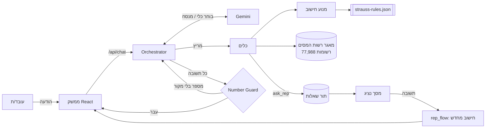

# ארכיטקטורה

## העיקרון: המודל מדבר, הקוד מחשב

| שכבה | קבצים | אחריות | מה אסור לה |
|---|---|---|---|
| מנוע | `engine/` | זכאות, שווי שימוש, נטו, השוואה, trace | לפנות למודל שפה; לנחש ערך חסר |
| כללים | `config/strauss-rules.json` + `engine/rules.py` | תקציבים, מסלולים, שיטת הנטו — כנתונים עם ולידציה | להכיל לוגיקה |
| סוכן | `agent/` | להבין את העובד, לבחור כלי, לנסח | לחשב; לכתוב מספר שלא הגיע מכלי |
| שמירה | `store.py` | שיחות, חשבונות ושאלות לנציג (SQLite או PostgreSQL), שורד רענון והפעלה מחדש | — |
| API | `api/` | חוזים (`contracts.py`), הרשאות (`auth.py`) | — |

## "לא מנחשים" — שלוש שכבות

1. **המנוע:** לכל נתון יש מקור (`Tracked.source`). נתון חסר → החלופה `partial` בלי מספרים.
2. **הכלים:** מאמתים כל קלט (עיסוק מהטבלה, רכב מהקטלוג או מפתח קיים במאגר). שגיאה חוזרת למודל, לא לעובד.
3. **Number Guard:** כל סכום בש״ח או אחוז בתשובה חייב להופיע בתוצאת כלי, בפרופיל, בכללים או במה שהעובד כתב. אחרת — ניסוח מחדש פעם אחת, ואז תשובה בטוחה קבועה.

## זיהוי רכב

- **רכב חדש** — רק מהקטלוג (20 רכבים). קוד סוג הרכב, שחסר בקטלוג, מושלם מהמאגר לפי תאור הדגם; התאמה לא חד-משמעית = שגיאה.
- **הרכב של היום** — כל רכב במאגר, לפי המפתח המלא. אותו כינוי ושנה מופיעים בכמה רמות גימור עם שווי שימוש שונה (קורולה 2021: 2,780–3,660 ₪), וקוד דגם ייחודי רק בתוך יצרן. לכן הסוכן מציג את האפשרויות ולא בוחר; אם העובד לא בטוח — הנציג מזהה לפי מספר הרישוי ובוחר מהמאגר.

## החלטות מכוונות לפיילוט, ומה משתנה בהיקף מלא

| החלטה היום | למה זה מספיק לפיילוט | המעבר להיקף מלא |
|---|---|---|
| SQLite (WAL) מקומית, PostgreSQL כש-`DATABASE_URL` מוגדר; JSON לכל שיחה | עשרות שיחות במקביל; אותו SQL בשני המסדים, והבדיקות רצות מול שניהם | Connection pool ומיגרציות מסודרות (Alembic) |
| עדכון מסך העובד בשאילתה כל 3 שניות | פשוט ואמין, עובד מאחורי כל פרוקסי | SSE / WebSocket מאותו endpoint |
| קודי גישה לנציג ולמנהל (`auth.py`) | חוסם גישה מקרית בדמו ובפיילוט קטן | SSO ארגוני (Azure AD) — אותה תלות `require(role)` |
| Gemini דרך מפתח API | מהיר להקמה | Vertex AI — שינוי ב-`.env` בלבד (ראו PRIVACY.md) |
| מודל ראשי + גיבוי (`gemini-3.5-flash-lite` → `3.1-flash-lite`) | עמידות לעומס ולמכסה | אותו מנגנון, מכסה בתשלום |
| חישוב חודשי לפי `taxYear: 2025` בקובץ הכללים | אין בחירת שנת מס לפי תאריך; יש לוודא מול דרישות האתגר שהשנה וההנחות עדיין מתאימות | חיבור למנוע השכר של החברה — המנוע מקבל `NetInput`, מחליפים את `compute_net` |
| עובדי דמו וקטלוג מקובץ | הנתונים פיקטיביים | חיבור למערכת השכר ולקטלוג הצי; `seed.py` הוא נקודת הכניסה |
